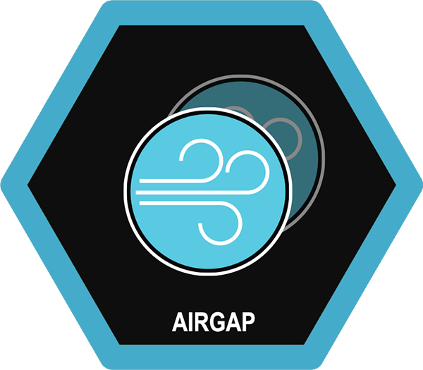
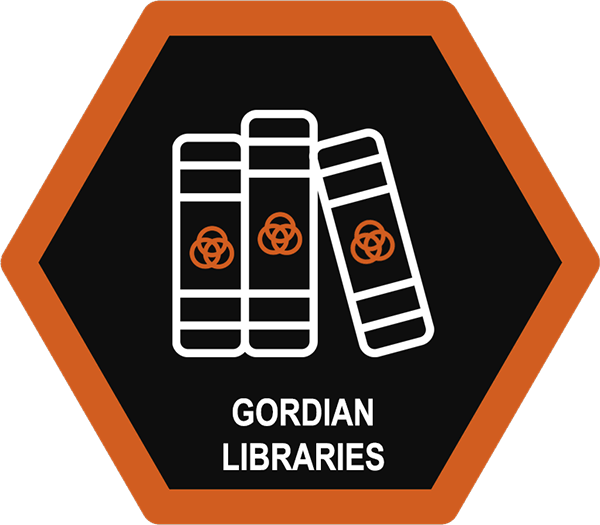
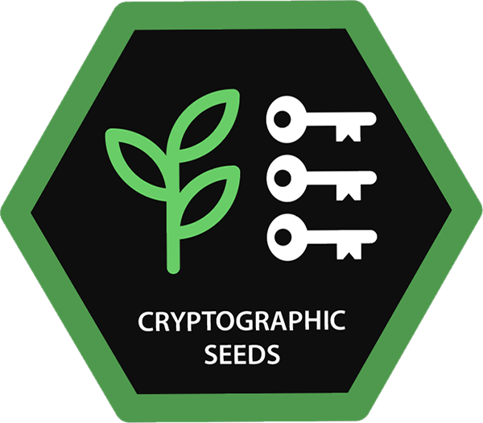

Blockchain Commons has a large list of technologies meant to support
the [Gordian Principles](/principles/). They can be overwhelming. The
following "Touchpoints" will help direct you to the technologies that
you need for your individual work.

* <a href="/touchpoints/psbt/"><b>Airgapping PSBTs</b></a>
   * _You are ..._ a Bitcoin wallet developer who wants to airgap their wallet, but needs a way to get large data packages like PSBTs across the gap.
   * _Prime Solutions:_ Animated QRs, a method for sequencing larger data packages.
* <a href="/touchpoints/stack/"><b>The Gordian Stack</b></a>   
   * _You are ..._ a developer focused on digital assets or identity and you've heard that Blockchain Commons has good support for privacy, resilience, self-sovereignty, or interoperablity.
   * _Prime Solutions:_ A variety of foundational technologies will improve data storage (through self-identifying, easily stored & transmitted format), data resilience (through Shamir's Secret Sharing and other solutions), data sequencing (through provenance marks), data identification (through lifehash and OIBs), data communication (again, through animated QRs), and even GitHub usage (through open integrity). Take a look and choose what works for you and your project!
* <a href="/touchpoints/seeds/"><b>Protecting Seeds</b></a>
   * _You are ..._ a Bitcoin wallet developer who wants to provide better resilience for your users' seeds and private keys.
   * _Prime Solutions:_ SSKR, which shards seeds, and CSR, which storse shares on remote servers.
* <a href="/touchpoints/ssi/"><b>Self-Sovereign Identity Designers</b></a>
   * _You are ..._ a self-sovereign identity developer who wants to see solutions from the inventor of the term.
   * _Prime Solutions:_ XIDs, a methodology for creating protected, self-sovereign identity that starts where DIDs stop.
   
