**Target Technology:** Digital Identity & Asset Systems 
**Target Audience:** Bitcoin Developers

_Blockchain Commons Bitcoin Stack is a huge collection of technologies
created over the course of a decade with the intent of supporting the
Gordian principles: we want to encourage the creation of digital
identity and asset systems where: users are independent and able to
make their own decisions; content is private, to protect users against
coercion; secrets are resilient, so that they're not lost; and
protocols are open, allowing everyone to interoperate within a shared
ecosystem. Each technology in the Gordian Stack is intended to meet
one or more of these goals._

_This is not a complete listing of Blockchain Commons specifications
(for that dig down from the [technologies](/technology/) page), but it
is extensive and covers the major building blocks in the stack._

## Data Formats

Data formats are the foundational blocks that we use to build up to
our principle-focused technologies.

<ul>
<li><a href="/bytewords/"><b>ByteWords</b></a> - A method
for encoding a binary byte as a four-letter word, useful for storing
secrets, but also a building block of URs.</li>
<li><a href="/dcbor/"><b>dCBOR</b></a> - A deterministic
version of the CBOR binary data format, allowing for the deterministic
hashed data elision used in Envelope.</li>
<li><a href="/envelope/">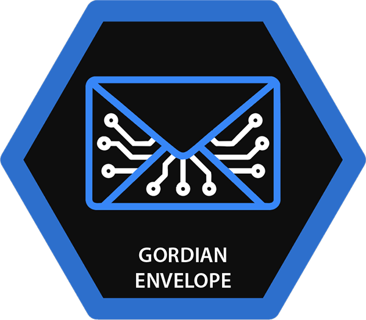<b>Gordian Envelope</b></a> - A
"smart" data storage format that incorporates compression, encryption, and
also deterministic hashed data elision. Built to support selective
disclosure, and a building block for XIDs.</li>
<li><a href="/ur/">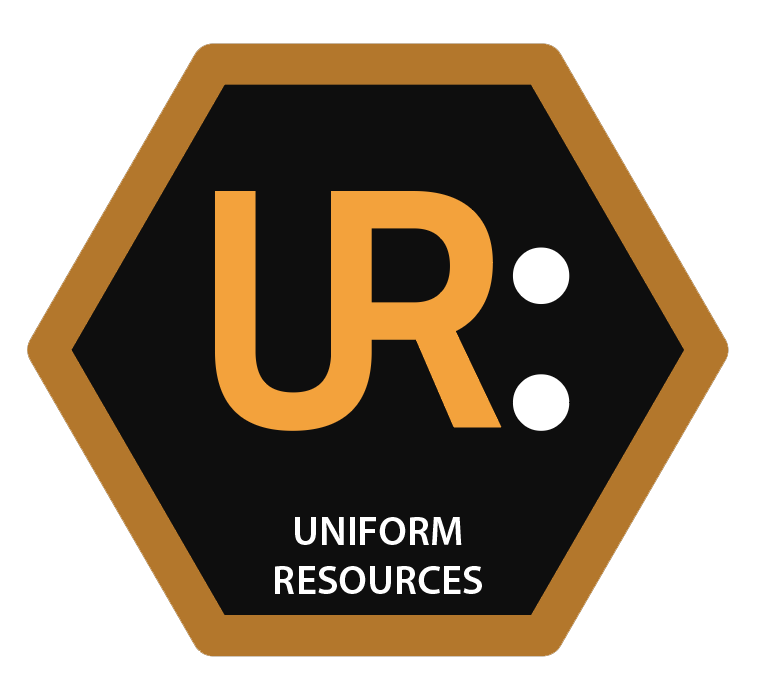<b>Uniform Resources (URs)</b></a> -
A method for encoding binary strings as text strings, using Bytewords.
A resilient data storage method and a building block of Animated QRs.</li>
</ul>

## Data Resilience

The Gordian Principles generally call for data to be self-sovereign:
held by the user.  But for that to work, the data must be resilient as
well.

<ul>
<li><a href="/csr/">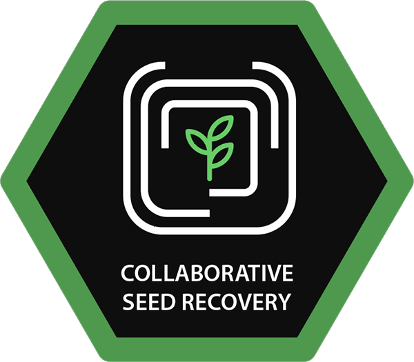<b>Collaborative Seed Recovery
(CSR)</b></a> - Using SSKR, CSR allows a user to shard a secret, store
it on remote servers, and later recover it from some of those shares.</li>
<li><a href="/sskr/">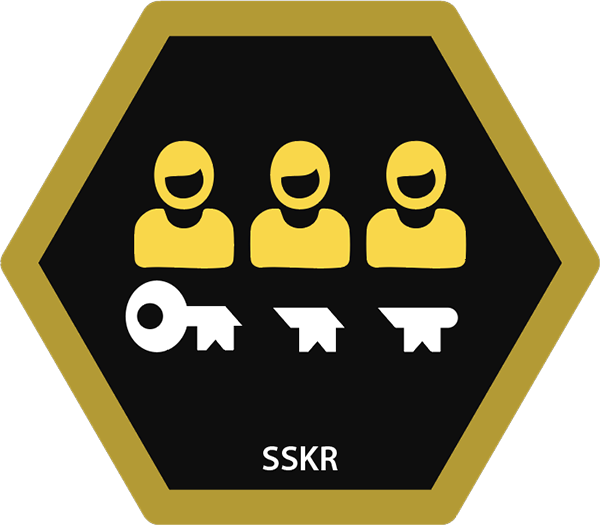<b>Sharded Secret Key
Reconstruction (SSKR)</b></a> - An expansion of Shamir's Secret Sharing
that allows the sharding of a secret and then its recovery from a
threshold of individuals or groups.</li>
</ul>

## Digital Signatures

Cryptographic signatures can prove identity and provenance. They link
to our digital identity systems and to data stoage systems like
Gordian Envelope.

<ul>
<li><a href="/open-integrity/">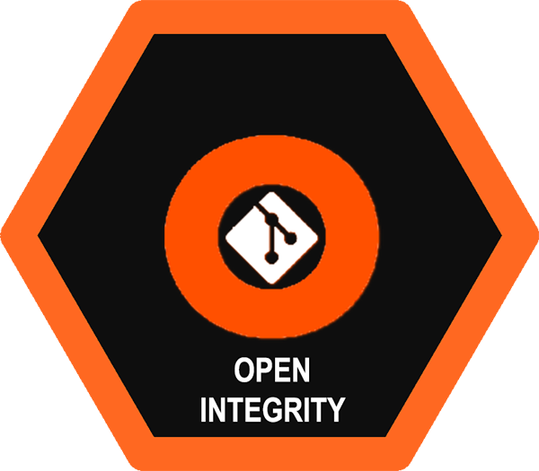<b>Open Integrity</b></a> - 
A system of signatures that proves the integrity and provenance of a Git repo.</li>
<li><a href="/provemark/">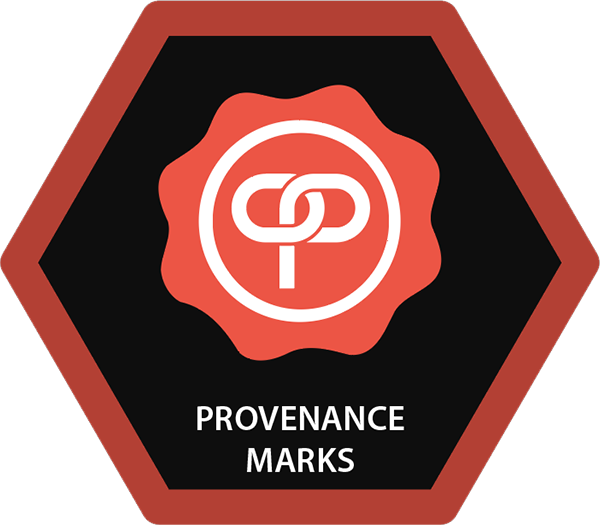<b>Provenance Marks</b></a>
Hash chains that link digital objects so that ordering can be proven.</li>
</ul>

_Blockchain Commons also supports third-party Schnorr signature
technologies such as [FROST](/frost/) and [MuSig2](/musig/)._

## Secure Communication

Secure communication is need to ensure interoperability and to provide additional resilience and privacy for users.

<ul>
<li><a href="/animated-qrs/">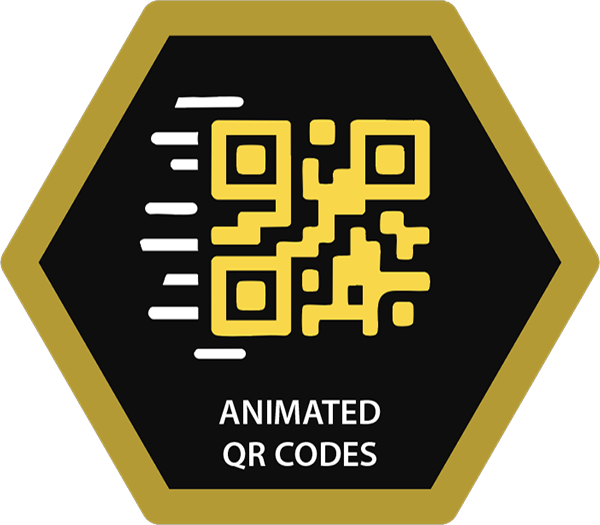<b>Animated QRs</b></a> - 
Animated QRs allow for the transmission of large amounts of information across airgaps in a self-describing way, using URs.</li>
<li><a href="/lifehash/">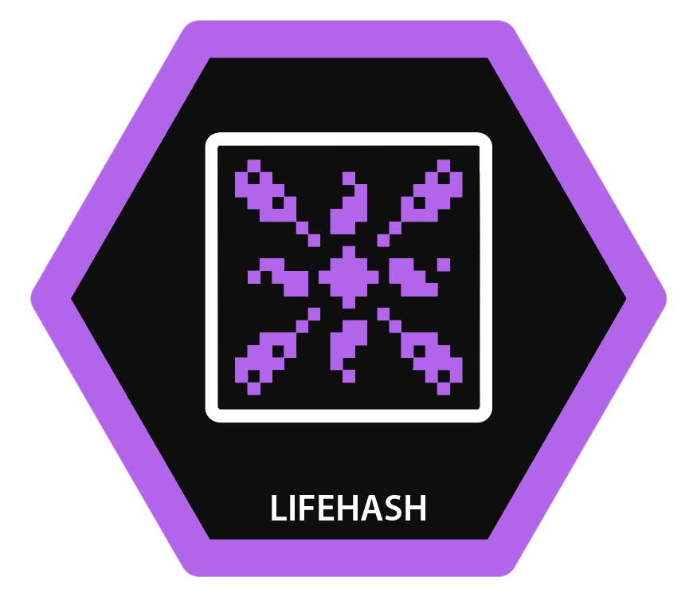<b>LifeHash</b></a> - 
Secure communication depends on knowing what you're transmitting. LifeHash enhances the recognition of big digital values.</li>
<li><a href="/oib/">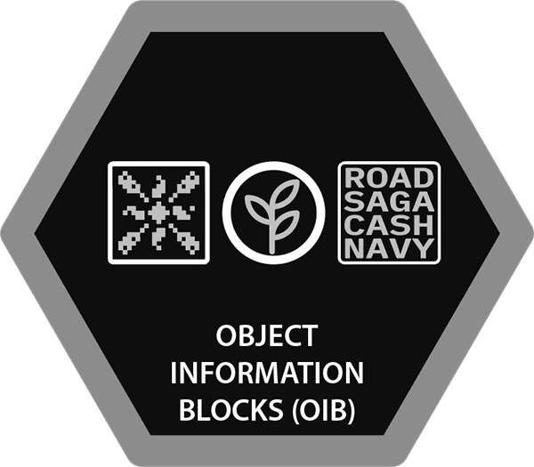<b>Object Identity Block (OIB)</b></a> - 
Lifehashes are just one element in an OIB, whose overall purpose is to aid in data recognition.</li>
</ul>

## Digital Identity

Digital identity is one of our capstones: much of our previous
technology has been built to support it.

<ul>
<li><a href="/cliques/">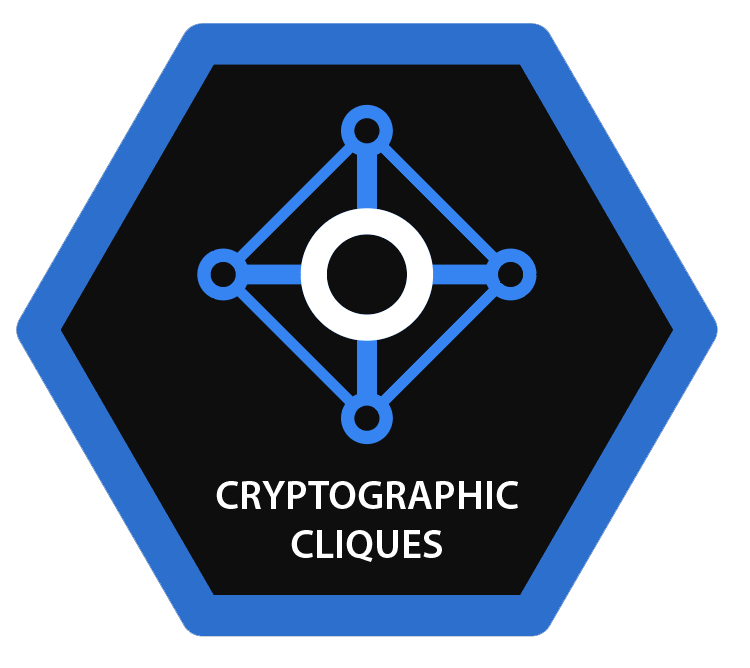<b>Cryptographic Cliques</b></a>
- A model for identity that uses signatures to define
relationships beetween entities.</li>
<li><a href="/cloudflare-passkey/">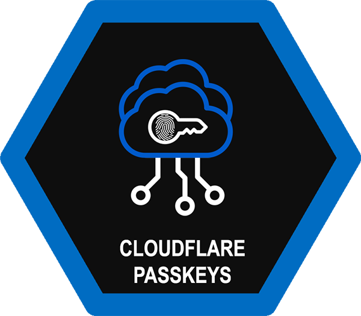<b>Cloudflare Passkey</b></a> -
A passkey-only identity system built on Cloudflare Workers and Durable Objects.</li>
<li><a href="/clubs/">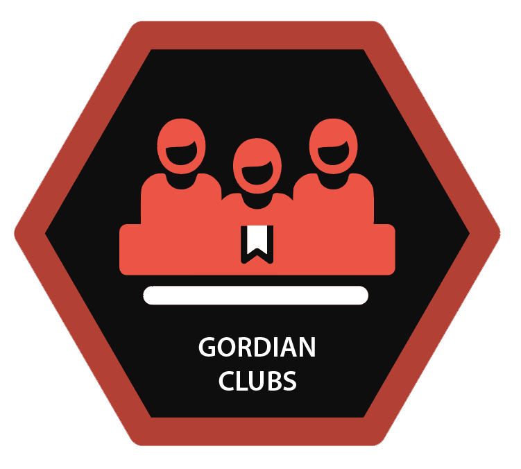<b>Gordian Clubs</b></a> - A
method of self-sovereign communication intended to allow the
transmission of information by members of a club.</li>
<li><a href="/xid/">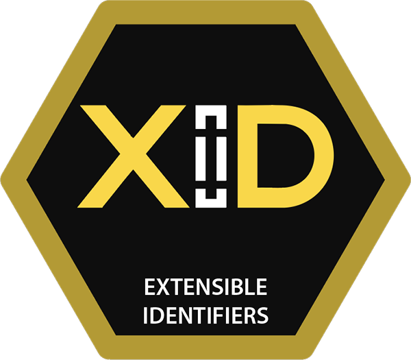<b>XIDs</b></a> - Our
best-developed system for self-sovereign identity, built on top of
Gordian Envelope as an autonomous cryptographic object that the user
controls.</li>
</ul>

