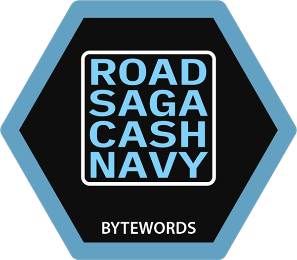
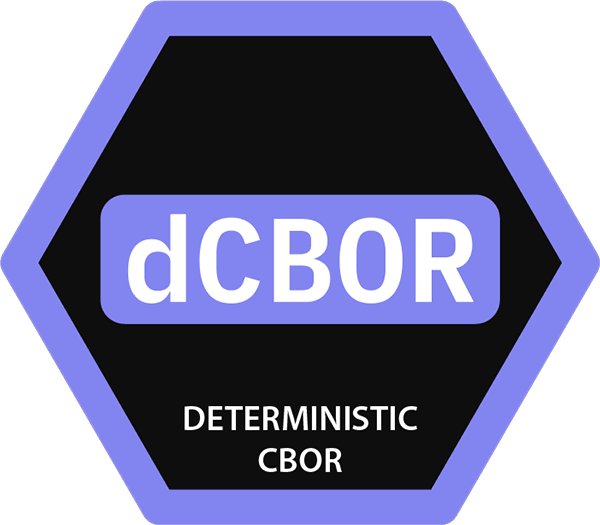

**Target Technology:** Digital Identity & Asset Systems 
**Target Audience:** Bitcoin Developers

_Blockchain Commons Bitcoin Stack is a huge collection of technologies
created over the course of a decade with the intent of supporting the
Gordian principles: we want to encourage the creation of digital
identity and asset systems where: users are independent and able to
make their own decisions; content is private, to protect users against
coercion; secrets are resilient, so that they're not lost; and
protocols are open, allowing everyone to interoperate within a shared
ecosystem. Each technology in the Gordian Stack is intended to meet
one or more of these goals._

_This is not a complete listing (for that dig down from the
[technologies](/technology/)), but it is extensive and covers the
major building blocks in the stack._

## Data Formats

Data formats are the foundational blocks that we use to build up to
our principle-focused technologies.

<ul>
<li><b>dCBOR</b> - A method for encoding a binary byte as a four-letter word, useful for storing secrts, but also a building block of URs.
<li><b>dCBOR</b> - A deterministic
version of the binary data format, allowing for the deterministic
hashed data elision used in Envelope.
<li><b>Gordian Envelope</b> - A "smart" data storage format that supports compression, encryption, and also deterministic hashed data elision. Built to support selective disclosure, and a build block for XIDs.
<li><b>Uniform Resources (URs)</b> - A method for encoding binary strings as text strings, using Bytewords, and a building block of Animated QRs.
</ul>